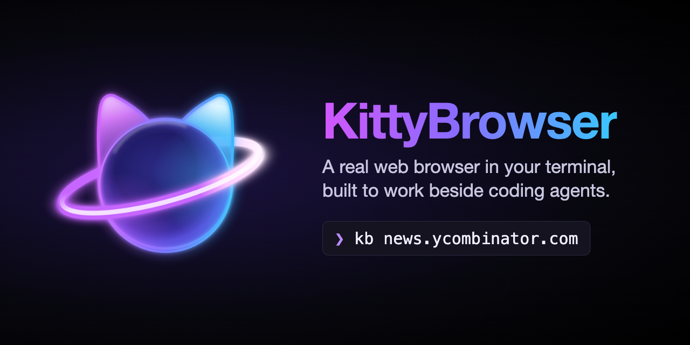
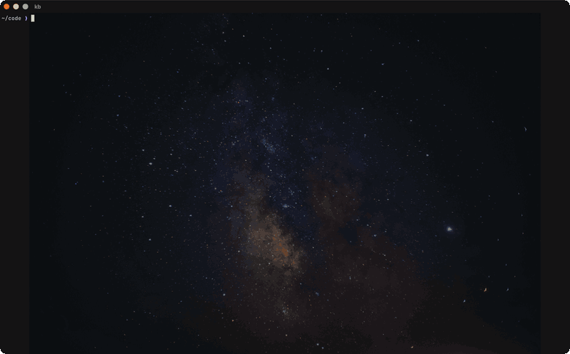

<p align="center">
  
</p>

<p align="center">
  <a href="https://github.com/graiz/kittybrowser/actions/workflows/ci.yml"></a>
  <a href="LICENSE"></a>
  
  
</p>

# KittyBrowser (`kb`)

A real web browser in a terminal pane. kb drives headless Chrome and draws
each page as pixels with the
[kitty graphics protocol](https://sw.kovidgoyal.net/kitty/graphics-protocol/),
so you see the actual layout, fonts and images, not a text approximation, and
you can click, scroll, type, find, zoom and copy in it.

<p align="center">
  
</p>

It is built for working beside a coding agent. The agent opens kb in the pane
next to its own, and you both look at the same page while it loads your dev
server, checks for console errors, clicks through a flow, tries a phone
width, or reads documentation, all through `kb ctl`.

```sh
kb http://localhost:3000        # open a page in this pane
kb ctl check                    # from another pane: is the page healthy?
kb skill install                # teach Claude Code (or any agent with skills) to use it
```

**Status:** early but usable, version 0.2. Used daily on macOS in Rex and
Ghostty; it should work in kitty and WezTerm, and it builds on Linux, but
those haven't been tested yet. Reports are welcome, and if kb is useful to
you, a star helps other people find it.

## Quick start

With Chrome installed:

```sh
brew install graiz/tap/kittybrowser
kb doctor                  # checks your terminal and Chrome, and says what to fix
kb news.ycombinator.com
```

Ctrl+/ shows the keys, Ctrl+Q quits (or the ✕ at the right of the bar, which asks first).
A window a page opens, such as a sign-in popup, is shown over the page;
‹ › in the bar switch between open windows, and ✕ closes the one shown.
Downloads go where Chrome puts them, usually `~/Downloads`, and the bar
shows how far one has come while it runs.

Without Homebrew, see [Install](#install) for the install script and
`cargo install`.

## Requirements

- **A terminal with the kitty graphics protocol:**
  [Ghostty](https://ghostty.org), [kitty](https://sw.kovidgoyal.net/kitty),
  [WezTerm](https://wezterm.org) or [Rex](https://www.superlogical.com).
  Terminal.app and iTerm2 don't support it, and kb doesn't work inside tmux,
  screen or Zellij.
- **Chrome, Chromium, Edge or Brave**, installed where kb can find it, or
  named with `KB_CHROME`.
- **Rust** (stable, from [rustup](https://rustup.rs)) only to build it from
  source; Homebrew and the install script use a prebuilt kb.

`kb doctor` checks the first two. kb itself asks the terminal when it starts,
and if it can't draw kitty graphics, says so and why instead of showing a
blank pane; `KB_FORCE=1` skips the question.

## Install

Each release has a prebuilt kb for macOS and Linux, on Apple Silicon, ARM
and Intel. Install it whichever way suits you:

```sh
brew install graiz/tap/kittybrowser     # Homebrew, on macOS or Linux

curl -fsSL https://raw.githubusercontent.com/graiz/kittybrowser/main/install.sh | sh

cargo install kittybrowser              # builds from crates.io; needs Rust
```

The install script puts kb in `~/.local/bin` (`KB_INSTALL_DIR` to put it
elsewhere). Where there is no prebuilt kb, such as a Linux that uses musl,
it builds with cargo instead, so it needs Rust there.

### macOS

```sh
brew install --cask google-chrome       # if you don't have Chrome
brew install graiz/tap/kittybrowser
kb https://example.com
```

On a non-retina display, start it with `kb --scale 1`.

### Linux

Install Chrome or Chromium from your distribution or google.com/chrome, then
kb with any of the ways above, and:

```sh
kb --scale 2 https://example.com    # --scale 2 on a HiDPI screen; the default is 1
```

kb looks for `google-chrome`, `google-chrome-stable`, `chromium`,
`chromium-browser`, `microsoft-edge` and `brave-browser` on your `PATH`; set
`KB_CHROME=/path/to/browser` for anything else. Linux builds cleanly but is
untested, so please open an issue with what you find.

### From source

The latest code on main, not yet released:

```sh
cargo install --git https://github.com/graiz/kittybrowser
```

Or from a clone:

```sh
git clone https://github.com/graiz/kittybrowser
cd kittybrowser
cargo install --path .
```

### Windows

kb doesn't run natively on Windows: it needs a Unix terminal and Unix
sockets. Use it inside WSL 2 with Chrome or Chromium installed on the Linux
side, from a terminal with the kitty graphics protocol (WezTerm runs on
Windows). This is untested.

### Updating

Update the way you installed: `brew upgrade kittybrowser`, the install
script again, or `cargo install kittybrowser` again (add `--force` if it says
kb is already installed). To hear about new versions, watch the repository
on GitHub for releases; the [CHANGELOG](CHANGELOG.md) says what changed. If
you use the agent skill, run `kb skill install` afterwards so it matches the
new version.

### Uninstalling

```sh
kb skill remove                 # if you installed the agent skill
kb mcp off                      # if you turned on the MCP server
brew uninstall kittybrowser     # or cargo uninstall kittybrowser,
                                # or rm ~/.local/bin/kb from the install script
rm -rf ~/.kittybrowser          # history, profiles and cookies
```

## Using kb

```sh
kb                     # start with the address field focused
kb example.com         # open a page
kb rust traits         # anything that isn't an address is a web search
kb ./page.html         # a local file
```

The top row holds back, forward and reload buttons and the address field; the
page fills the rest of the pane. The mouse works on both: click the buttons,
click the address to edit it, and click, drag and scroll the page.

| Key | Does |
| --- | --- |
| Cmd+L or Ctrl+L | Edit the address (it starts selected, so typing replaces it) |
| Enter / Esc | Go to the address / cancel the edit |
| Right, End | Accept the suggested completion (Backspace rejects it) |
| Cmd+F or Ctrl+F | Find on the page. Enter and Shift+Enter (or Cmd+G, Shift+Cmd+G) go to the next and previous match; Esc closes |
| Ctrl+[ and Ctrl+], or Alt+Left and Alt+Right | Back, forward |
| Cmd+R or Ctrl+R | Reload |
| Cmd+C or Ctrl+C | Copy the selection (or the address while editing it) to the system clipboard |
| Ctrl+Shift+C or Cmd+Shift+C | Inspect: hover to outline elements, click one for its selector, size and styles |
| F12, Ctrl+Shift+I or Cmd+Alt+I | Open Chrome DevTools for the page (start kb with `--devtools`) |
| Ctrl+= and Ctrl+- | Zoom in and out; the zoom shows at the right of the bar |
| Ctrl+0 | Zoom to 100%, or out until a page too wide for the pane fits |
| Ctrl+/ | Help: the keys, and the page, zoom, viewport and pane sizes |
| Ctrl+Tab, Ctrl+PageDown | Next window: a popup or a new tab a page opened (‹ › in the bar) |
| Ctrl+Shift+Tab, Ctrl+PageUp | Previous window |
| Ctrl+W | Close the window shown (✕); on the last one, ask to quit |
| Ctrl+Q | Quit (the ✕ at the right of the bar closes a popup, or asks first) |

Every other key goes to the page. The mouse's back and forward buttons go
back and forward. `kb keys` lists the bindings; change them in
`~/.kittybrowser/keys`, one per line (`ctrl+shift+i devtools`, or
`alt+left none` to let the page have a key), and running kbs pick up the
change at once.

- **Command keys** need a terminal with the kitty keyboard protocol that
  doesn't keep them for itself. In Rex, Cmd+F, Cmd+G and Cmd+R are Rex's own,
  so use Ctrl+F, Ctrl+G and Ctrl+R there. Ctrl+[ and Ctrl+] also need the
  protocol.
- **Address completion** comes from pages you have visited, kept in
  `~/.kittybrowser/history`. Nothing you type is sent to a suggestion
  service.
- **Cookies and logins** are kept in `~/.kittybrowser/profile`, separate from
  your everyday Chrome.
- **Several kbs** can run at once, one per pane, and `kb list` numbers them.
  Chrome won't share a profile, so the second and later ones have their own
  cookies (`profile-2`, ...); history is shared.
- **A named kb**, `kb --name work`, answers to `kb ctl -i work` and always
  keeps its cookies in `~/.kittybrowser/profiles/work`, however many other
  kbs are running: sign in there once and it stays signed in.
- **Copying** goes through the terminal (OSC 52), so it reaches your
  clipboard even over SSH. It catches what pages copy themselves, such as a
  code block's copy button.
- **Colours:** the bar takes the terminal's colours, and pages are told you
  prefer dark mode when the terminal's background is dark. `--dark` or
  `--light` overrides that.
- **The mouse pointer** changes over links, text and controls, in terminals
  that support it (kitty, Ghostty).
- **Zoom** reflows the page as in a desktop browser. Zoomed in, text is a
  little soft, because Chrome renders at 100% and the image is enlarged.

## For coding agents

```sh
kb skill install    # installs the skill to ~/.claude/skills/kb
```

The skill teaches an agent (Claude Code, or any agent that reads skills) to
open kb in a pane beside its own, find which kb is its own, and work in it
while you watch. Its text is [`skill/SKILL.md`](skill/SKILL.md); `kb skill
show` prints it.

Any program can drive a running kb with `kb ctl`:

```sh
kb ctl open http://localhost:3000    # waits for the load, reports errors
kb ctl check                         # exit 1 on console errors, failed requests or an error page
kb ctl click 'text=Save'             # reports the errors, dialogs and downloads it causes
kb ctl screenshot --out page.png
kb ctl viewport 375x800              # a phone width; viewport reset to undo
kb ctl outline                       # read a page: headings, then...
kb ctl text --section Installation   # ...just one section
```

With nobody watching (a script, CI, or an agent whose pane the user
closed), `kb --headless URL` runs the same browser in the background
without a pane and prints its id; `kb ctl -i ID quit` stops it, and it
stops by itself after ten minutes without a command.

For a browser that runs unattended, as a service or for a scheduled agent,
give it a name: `kb --headless --name bot URL` keeps its own profile, so a
site signed in to once stays signed in, and never touches your own kbs.
`KB_HEADLESS_IDLE=0` keeps it running until `kb ctl -i bot quit`. To sign
in by hand first, run `kb --name bot` in a pane, sign in, and quit it.

`kb ctl --help` lists every command and `kb ctl <command> --help` describes
one:

- **Navigating:** open, reload, back, forward, status, check, viewport, quit.
- **Reading:** outline, text (the main content, an element, or
  `--section HEADING`), find, links, tables, images, html, screenshot
  (`--size small|normal|sharp|WIDTH`).
- **Acting:** click (`--double`, `--at X,Y`), hover, type, select, upload
  (files for a file field, or the chooser a button opens), press, scroll,
  wait, dialog, window (list a page's popups and switch between them),
  throttle, scheme (dark or light mode).
- **Debugging:** console, network, eval, style (`--why` explains which CSS
  rule won), box, listeners, storage, clear-storage (cookies and storage
  for the site, to test a first visit).
- **Asking the user:** pick (the user clicks an element in the pane, and
  the agent gets its selector).

Selectors are CSS (reaching into shadow DOM, and with `iframe >>> sel`
into a frame from the same site), `text=Some words`, `@N` from
`kb ctl links`, or `:focus`. With several kbs running, pick one with
`kb ctl -i N` (its number in `kb list`), `-i ID` (its id, such as `3-a7f2`,
which unlike the number isn't reused by a kb started later), or `-i NAME`.
Without one, `kb ctl` and the MCP server go to the kb in the caller's Rex
session, if there is one (several is an error), else the lowest-numbered.

The same commands are available as an MCP server, which is off until you turn
it on: `kb mcp on` (it prints how to register it with Claude Code), `kb mcp
off`, `kb mcp status`. `kb mcp serve -i NAME` drives only the kb with that
name, so an agent given it can't reach the kbs in your panes. Add
`--read-only` to offer only the tools that read (status, text, screenshot,
storage and the like) and refuse the rest, or `--tools open,text,screenshot`
to offer only those; `--read-only` wins over `--tools`. Each tool tells the
client whether it only reads or can destroy something (`click`, `type`,
`eval`, `clear-storage`, `quit`), so a client can ask before those.

**Security:** kb listens on a socket in `~/.kittybrowser` that only your user
can open. Anything running as you can use that socket to run JavaScript in
pages you are logged in to in kb. Such a program could already read your
files, but it's worth knowing before you turn on the MCP server. The folder
and its profiles are yours alone, as are the screenshots and frames kb
leaves in the temporary directory. `upload` sends files
from your computer to the page, so an agent driving kb can send any file
you can read, except ones that look like keys, passwords or sign-ins
(`~/.ssh`, `~/.aws`, `.env` files, private keys, browser cookies): those
only you can send, by choosing them in the page's file chooser, which agents
can't see or drive. See
[SECURITY.md](.github/SECURITY.md).

## Configuration

| Setting | Does |
| --- | --- |
| `--scale N` | Device pixels per CSS pixel: 2 by default on macOS, 1 elsewhere |
| `--dark`, `--light` | The colour scheme pages are told you prefer; by default, the terminal's |
| `--name NAME` | Answer to `kb ctl -i NAME` and keep a profile of its own, `~/.kittybrowser/profiles/NAME` |
| `--devtools` | Serve Chrome DevTools on a port of 127.0.0.1, for F12 (any program on this machine can then reach the browser) |
| `~/.kittybrowser/keys` | Key bindings; `kb keys` shows the format and what's bound |
| `KB_CHROME` | The browser to run, if kb doesn't find one |
| `KB_CHROME_ARGS` | Extra flags for Chrome, separated by spaces |
| `KB_TRANSFER=pty` | Always send frames through the terminal, never by file |
| `KB_TRANSFER=png` | Through the terminal, and each frame whole as a PNG: for a terminal that shows kb's page broken over ssh |
| `KB_FORCE` | Start without asking the terminal whether it draws kitty graphics |
| `KB_HEADLESS_IDLE` | Seconds a headless kb (`kb --headless`) waits for a command before quitting by itself; default 600, and 0 for never |
| `KB_LOG` | A file to append diagnostics to (sizes, frames, clicks) |

## Troubleshooting

Start with `kb doctor`: it checks the terminal, tmux and Zellij, Chrome and
kb's data folder, and prints what to fix.

- **Over ssh:** kb works, drawing through the terminal and sending only
  what moved or changed: a scroll step is a few KB. OpenSSH 10 and later
  hold back what you type for up to 20 ms to hide your typing rhythm; for a
  host you trust, `ObscureKeystrokeTiming no` in its `~/.ssh/config` block
  makes typing into kb quicker.
- **"no Chrome, Chromium, Edge or Brave found":** install one, or set
  `KB_CHROME`.
- **"doesn't support the kitty graphics protocol":** kb asks the terminal
  when it starts, and stops if the answer is no, as in Terminal, iTerm2 or
  VS Code's terminal, or inside tmux, screen or Zellij. Run it in Ghostty,
  kitty, WezTerm or Rex.
- **Nothing is drawn, or escape codes appear:** the terminal didn't answer
  kb's question in time (over a very slow link, say), and doesn't support
  the protocol either.
- **The page is blurry or tiny:** set `--scale` to your display's pixel
  ratio.
- **Pages are slow on Apple Silicon, or a heavy one never finishes
  loading:** check `kb doctor` for a note that kb is an Intel build. It
  starts Chrome natively anyway, but reinstall kb for Apple Silicon:
  `rustup target add aarch64-apple-darwin`, then
  `cargo install --path . --target aarch64-apple-darwin`.
- **Sites show their phone layout:** the pane is narrow. Widen it, zoom out
  with Ctrl+-, or have the agent run `kb ctl viewport 1280`.
- **A kb you can't find:** `kb list` shows the ones running, with the pane
  each is in; quit one with Ctrl+Q in its pane.
- **"Chrome didn't answer" or "didn't start loading" at start, on macOS:**
  Chrome may be waiting for the keychain, which holds the key it encrypts
  cookies with. This happens when kb runs with a `HOME` that isn't your own,
  or as a service before you have logged in. Run kb with your own `HOME`,
  from a session that is logged in. `KB_CHROME_ARGS=--use-mock-keychain`
  also works, but then cookies are stored with a fixed key, readable by
  anyone who can read the profile.
- **"longer than a Unix socket's path can be":** kb's socket lives in
  `~/.kittybrowser`, and Unix sockets allow about 100 characters of path.
  Run kb with a shorter `HOME`.

## Documentation

- [docs/ARCHITECTURE.md](docs/ARCHITECTURE.md): how kb works, and the
  decisions behind it.
- [docs/ROADMAP.md](docs/ROADMAP.md): goals, non-goals and what's next.
- [CHANGELOG.md](CHANGELOG.md): what changed in each version.
- [CONTRIBUTING.md](.github/CONTRIBUTING.md): reporting bugs and sending pull
  requests.
- [AGENTS.md](AGENTS.md): instructions for coding agents working on this
  repository.

## License

MIT. See [LICENSE](LICENSE).
